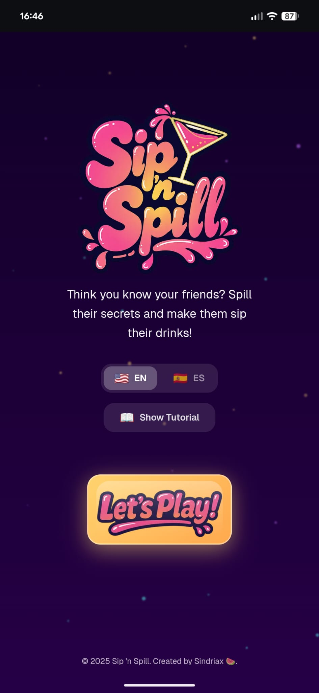

# Sip 'n Spill

A drinking game web app with a twist: instead of sharing your own secrets, you bet on what your friends have done.

> **18+** | Please drink responsibly

Live at [sip.sindriax.dev](https://sip.sindriax.dev).

## How to Play

1. **The Guesser** reads a card silently
2. **Place your bets** about each player: did they do it or not?
3. **Reveal** the card out loud and everyone confesses
4. **Sip time!** Caught someone? They sip. Got anyone wrong? The Guesser sips

## Modes

- **Classic**: the bet-on-your-friends game. Mix any of three vibes: Warmup, Spicy, Unhinged
- **Hot Seat**: every card names a player; everyone else bets on them
- **Spill 1:1**: confession cards for two
- Nearly 1,000 cards in English and Spanish
- Optional player names to track whose turn it is, remembered between sessions
- Screen stays awake while playing, and the last deck is cached so a flaky bar connection doesn't stop the game

## Screenshots

  <table>
    <tr>
      <td align="center"><br><em>Home</em></td>
      <td align="center"><br><em>Gameplay</em></td>
    </tr>
  </table>

## Tech Stack

- Next.js 15 (static export), TypeScript, Tailwind CSS, Framer Motion
- Cloudflare Workers serving the static site plus `/api/questions`
- Cloudflare D1 for the question decks

## Development

```bash
npm install
npm run db:migrate:local
npm run db:seed:local
npm run dev:api   # Worker + local D1 on :8787
npm run dev       # Next.js on :3000, proxies /api to the Worker
```

`npm run preview` builds the static site and serves the whole thing through the Worker, exactly as deployed.

## Questions

The decks live in `src/data/questions_en.json` and `src/data/questions_es.json`, grouped by category (`chill`, `spicy`, `unhinged`, `hotseat`, `date`). Hot Seat cards use `{player}` as the placeholder for the name.

After editing them, reseed:

```bash
npm run db:seed:local
npm run db:seed:remote
```

## Deploy

```bash
npm run db:migrate:remote   # only when worker/migrations changed
npm run deploy
```

## Created by

[Sindriax](https://github.com/sindriax)
